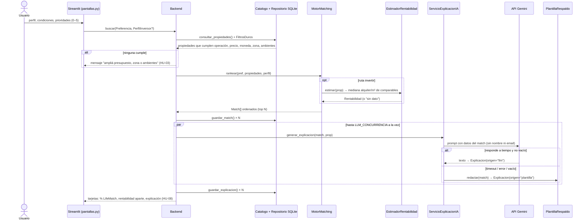
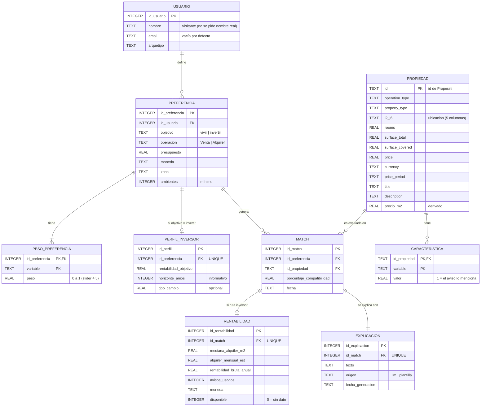

# Arquitectura y esquema de datos

Este documento describe **cómo está construido el código**. Corresponde al punto 5 del TP (diagrama de clases y DER, diagrama de integración de IA), pero tomado del código en sí y no del diseño previo. Las diferencias con el DOCX se listan al final.

## 1. Capas

| Capa | Responsabilidad | Módulos | HU |
|---|---|---|---|
| Presentación | Pantallas tipo asistente (perfil → condiciones → prioridades → resumen → resultados). Sin reglas de negocio. | `ui/pantallas.py`, `ui/logica.py` (funciones puras, testeables sin Streamlit) | HU-01, HU-02, HU-08 |
| Caso de uso | Orquesta una búsqueda: filtrar → puntuar → explicar → persistir. | `backend.py` | todas |
| Dominio | Entidades del TP y reglas (validación, filtros duros, pesos). | `modelos.py`, `arquetipos.py`, `filtros.py` | HU-01, HU-02, HU-03 |
| Cálculo (🤖 IA, determinístico) | LifeMatch por suma ponderada normalizada; rentabilidad bruta por medianas de comparables. | `matching.py`, `rentabilidad.py` | HU-05 |
| Explicación (🤖 IA, LLM) | Arma el prompt, llama a Gemini con timeout y, si falla, recurre a la plantilla. | `explicacion/servicio.py`, `explicacion/cliente_llm.py`, `explicacion/plantilla.py` | HU-06, HU-07 |
| Datos | Carga y normalización del CSV de Properati; persistencia SQLite. | `catalogo.py`, `repositorio.py` | HU-04 |
| Configuración | Variables de entorno, sin secretos en el repo. | `config.py`, `.env.example` | — |

Regla de dependencia: la presentación solo conoce al `Backend` y a `ui/logica.py`; el dominio no importa Streamlit, SQLite ni Gemini. Por eso el 95 % de la lógica se prueba sin interfaz y sin red.

## 2. Estructura de carpetas

```text
lifematch-asistente-inmobiliario/
├── app.py                         # punto de entrada: streamlit run app.py
├── requirements.txt               # streamlit, google-genai, pytest
├── pytest.ini                     # pythonpath = src
├── .env.example                   # variables de entorno (sin valores secretos)
├── src/inmobiliaria/
│   ├── config.py                  # DB_PATH, TOP_N, LLM_TIMEOUT_S, LLM_CONCURRENCIA, MIN_AVISOS_ALQUILER
│   ├── modelos.py                 # Usuario, Preferencia, PerfilInversor, Propiedad, Match, Rentabilidad, Explicacion
│   ├── arquetipos.py              # pesos por defecto de los 5 perfiles (HU-01)
│   ├── filtros.py                 # FiltrosDuros (HU-03)
│   ├── catalogo.py                # Catalogo: carga CSV por lotes, normalización, palabras clave (HU-04)
│   ├── repositorio.py             # RepositorioSQLite: esquema y consultas
│   ├── matching.py                # MotorMatching → LifeMatch 0–100 (HU-05 🤖)
│   ├── rentabilidad.py            # EstimadorRentabilidad (HU-05 🤖, ruta inversor)
│   ├── backend.py                 # Backend.buscar(): caso de uso completo
│   ├── explicacion/
│   │   ├── cliente_llm.py         # ClienteLLM (interfaz) + ClienteGemini (HU-06 🤖)
│   │   ├── servicio.py            # ServicioExplicacionIA: prompt, timeout, validación (HU-06/07 🤖)
│   │   └── plantilla.py           # PlantillaRespaldo (HU-07 🤖)
│   └── ui/
│       ├── pantallas.py           # Streamlit
│       ├── logica.py              # formateo, sliders→pesos, orden (puro)
│       └── demo.py                # ClienteDemo + catálogo sintético (modo DEMO=1)
├── scripts/
│   ├── cargar_catalogo.py         # importa data/properati.csv a SQLite
│   ├── probar_gemini.py           # prueba MANUAL de la API real
│   └── demo_en_vivo.py            # demo por consola, sin red
├── tests/                         # un archivo por HU + integración + recorrido de UI
├── data/                          # muestra_demo.csv (sintético); properati.csv y *.db NO se suben
└── docs/                          # este documento, trazabilidad, reglas, registro de IA, guion de demo
```

## 3. Flujo de una búsqueda (integración de IA)



Qué se envía al LLM: un JSON con perfil/objetivo, datos de la propiedad, porcentaje, variables a favor (con aporte), en contra, sin dato y, para el inversor, rentabilidad con su alquiler base y la cantidad de avisos. **No** se envían nombre ni email del usuario. El LLM solo redacta: no filtra ni calcula.

Las llamadas al LLM se hacen en paralelo (`LLM_CONCURRENCIA`, 4 por defecto). Las escrituras en SQLite se hacen siempre en el hilo principal.

## 4. Esquema relacional SQLite

Fuente única: la constante `SCHEMA` en `src/inmobiliaria/repositorio.py` (se crea sola al abrir la base). El diagrama refleja ese esquema tal como está en el código.



`PROPIEDAD` conserva las 25 columnas originales del dataset (en el diagrama se resumen `l2`…`l6` y se omiten `ad_type`, fechas, `lat`, `lon`, `l1`, `bedrooms` y `bathrooms` para que se lea mejor). Índices: `ix_propiedad_busqueda (operation_type, currency, price, rooms)` para los filtros duros y `ix_propiedad_zona (l3, property_type, operation_type)` para medianas y comparables.

Restricciones que hacen cumplir reglas del TP:

- `preferencia.objetivo CHECK IN ('vivir','invertir')`.
- `perfil_inversor.id_preferencia UNIQUE` → 0..1 por preferencia.
- `rentabilidad.id_match UNIQUE` y `explicacion.id_match UNIQUE` → 0..1 y 1..1 por match.
- `explicacion.origen CHECK IN ('llm','plantilla')` → siempre se sabe si el texto lo escribió Gemini o la plantilla (HU-07).
- `PRAGMA foreign_keys = ON` en cada conexión.

## 5. Diferencias con el diseño del DOCX (para ajustar los diagramas o justificarlas)

1. `propiedad.id` es **TEXT** (el id de Properati no es entero garantizado); el diagrama de clases lo muestra como entero.
2. `Match.detalle` (peso, cumplimiento y aporte por variable) y `variables_sin_dato` **no se persisten**: se recalculan en cada búsqueda. Si el docente pide trazabilidad completa del cálculo, agregar una tabla `detalle_match(id_match, variable, peso, cumplimiento, aporte)`.
3. Solo se guardan los **top N** matches por búsqueda (`TOP_N`), no todas las propiedades que pasaron los filtros.
4. Las explicaciones se generan **al buscar** para el top N (no al abrir el detalle, como dice el primer criterio de HU-06), porque HU-08 pide la explicación en cada tarjeta.
